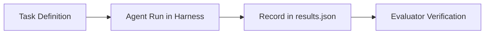

# Open Model Agent Benchmarks

An open, reproducible evaluation framework for measuring agentic capabilities of frontier open models (e.g., DeepSeek, GLM, Kimi, Qwen) across real-world agent harnesses (such as OpenAI Codex CLI, Claude Code, and OpenCode).

The benchmark evaluates models on realistic developer and agent workloads spanning complex coding, live web research, multi-step tool use, and multi-constraint reasoning.

---

## Repository Structure

```
open-model-agent-benchmarks/
├── tasks/                   # Canonical task definitions (JSON)
│   ├── coding/              # Real-world software engineering & debugging (C-01, C-02, C-03)
│   ├── web-search/          # Live web search & synthesis tasks (WS-01, WS-02, WS-03)
│   ├── tool-use/            # Tool calling & function interaction (T-01, T-02, T-03)
│   └── reasoning/           # Multi-step logical reasoning (R-01, R-02, R-03, R-04)
├── evaluators/              # Automated verification & evaluation suite
│   ├── run_evaluations.py   # Central evaluation CLI runner
│   ├── coding/              # Deterministic evaluators for coding tasks
│   ├── web-search/          # Deterministic evaluators for search tasks
│   ├── tool-use/            # Evaluators for tool-use tasks
│   └── reasoning/           # Evaluators for reasoning tasks
├── results.json             # Consolidated benchmark runs, logs, and verified scores
└── README.md
```

---

## How It Works

Each benchmark lifecycle consists of four decoupled stages:



1. **Task Definition (`tasks/`)**: Specifies the exact problem prompt, strict constraints, expected behaviors, and automated test requirements.
2. **Harness Execution**: The model is executed inside an agent environment (CLI harness, shell, tool environment) with real tools and workspaces.
3. **Run Logging (`results.json`)**: Raw logs, token costs, execution timings, and agent completion reports are recorded.
4. **Independent Evaluation (`evaluators/`)**: Deterministic evaluators audit the solution against every task requirement, preventing self-reported hallucinated scores.

---

## Adding New Tasks, Models, or Harnesses

Follow these steps to expand the benchmark with new tasks, models, or agent harnesses:

### Step 1: Define the Task

1. **Select or create the category folder**:
   - For existing domains, use `tasks/coding/`, `tasks/web-search/`, `tasks/tool-use/`, or `tasks/reasoning/`.
   - For a new domain (e.g., `data-analysis`), create a new folder under `tasks/<category>/`.
2. **Create the task specification file** (`tasks/<category>/<ID>.json`, e.g., `C-04.json` or `WS-04.json`):
   - Include `id`, `name`, `category`, `prompt`, `acceptanceCriteria`, and `evaluationConfig.checks`.

### Step 2: Run the Benchmark in Your Environment

1. Set up your target model and harness (e.g., Codex CLI, Claude Code, OpenCode, Aider, or custom agent runner).
2. Execute the agent against the task in a clean workspace:
   - Provide the task prompt and workspace files.
   - Let the agent utilize its available tools (terminal, editor, web search, etc.).
3. Note down the execution metrics:
   - Command run and session ID
   - Token usage (prompt, completion, cached, total) and API cost
   - Real, user, and system execution timings
   - Agent final response markdown and test outputs

### Step 3: Record the Run in `results.json`

Add the run record to the `runs` array in `results.json` following the benchmark schema:

```json
{
  "id": "run-<model>-<harness>-<task-id>",
  "taskId": "coding-C-04",
  "taskName": "C-04 — Task Title",
  "categoryId": "coding",
  "modelId": "deepseek-ai/DeepSeek-V4.1-Flash",
  "harnessId": "codex",
  "attempt": 1,
  "recordedStatus": "pass",
  "prompt": "...",
  "responseMarkdown": "...",
  "command": "bash scripts/run_codex.sh --task C-04 --model ...",
  "execution": {
    "tokens": { "totalTokens": 45000 },
    "cost": { "totalCost": 0.012, "currency": "USD" },
    "timings": { "realSeconds": 45.2 }
  },
  "evaluation": {
    "status": "not_independently_verified",
    "recordedStatusSource": "Workspace test suite passed: 10/10 tests."
  }
}
```

### Step 4: Create the Task Evaluator

Create an evaluator script under `evaluators/<category>/<evaluator_name>.py`:
1. Export `TASK_ID` (e.g. `"C-04"`), `CATEGORY_ID` (e.g. `"coding"`), and `EVALUATOR_VERSION`.
2. Implement deterministic validation functions for each check listed in the task's `evaluationConfig.checks`.
3. Expose an `evaluate(data)` function that returns:
   - `status`: `"pass"` or `"fail"` (or `"manual_review_required"` for subjective items)
   - `passed`: `true` or `false`
   - `reason`: Explanation of passed or failed checks
   - `checks`: Dictionary of boolean flags per check ID
   - `checkDetails`: Detailed diagnostic messages per check

### Step 5: Run Evaluation & Verify Accuracy

Use the central runner `evaluators/run_evaluations.py` to evaluate runs:

```bash
# 1. Preview evaluation without touching results.json:
python evaluators/run_evaluations.py --task C-04

# 2. Inspect individual task evaluator directly:
python evaluators/coding/c04_new_task.py

# 3. Write verified evaluation results and check details to results.json:
python evaluators/run_evaluations.py --task C-04 --write
```

The runner automatically updates `results.json` with:
- `verifiedResult`: `"pass"` / `"fail"`
- `statusMatchesRecordedStatus`: `true` / `false`
- `verificationMethod`: `"deterministic_task_specific_script"`
- Full checklist breakdown in `checks` and `checkDetails`

---

## Status Definitions

| Status | Meaning |
| :--- | :--- |
| `independently_verified` | Evaluator ran and confirmed all behavioral checks match the recorded result. |
| `not_independently_verified` | Recorded run added, but automated verification evaluator has not yet run. |
| `manual_review_required` | Output contains subjective claims or external dependencies requiring human inspection. |

---

## Running Evaluators (Quick Reference)

```bash
# Run all evaluators in preview mode
python evaluators/run_evaluations.py

# Evaluate a specific category
python evaluators/run_evaluations.py --category coding

# Evaluate a specific task
python evaluators/run_evaluations.py --task C-01

# Commit verified evaluation results to results.json
python evaluators/run_evaluations.py --task C-01 --write
```
